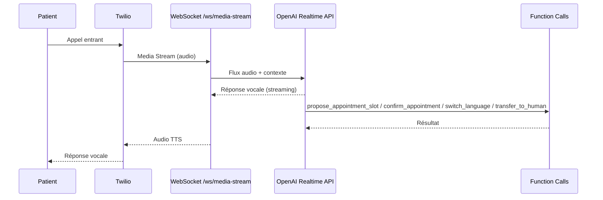

<div align="center">

# Secrétaire Médicale IA — Module 3

### Téléphonie & Assistant vocal IA

Réception et émission d'appels téléphoniques automatisées, pipeline vocal temps réel (STT → dialogue → TTS), prise de rendez-vous et détection d'urgence avec transfert humain — pour cabinets médicaux.

[](https://www.python.org/)
[](https://fastapi.tiangolo.com/)
[](https://www.postgresql.org/)
[](https://redis.io/)
[](https://www.docker.com/)
[](https://www.twilio.com/)
[](https://platform.openai.com/)

[](#roadmap)
[](#)

</div>

---

## Table of Contents

- [Overview](#overview)
- [How It Works](#how-it-works)
- [Tech Stack](#tech-stack)
- [Getting Started](#getting-started)
- [Environment Variables](#environment-variables)
- [Architecture](#architecture)
- [Scope](#scope)
- [Roadmap](#roadmap)
- [Testing](#testing)

---

## Overview

**Secrétaire Médicale IA** est le backend FastAPI du **Module 3** d'une plateforme de secrétariat médical assistée par IA. Il gère de bout en bout les appels téléphoniques d'un cabinet médical :

| Capacité | Détail |
|---|---|
| **Appels entrants** | Décroché automatique, dialogue naturel, prise de RDV |
| **Appels sortants** | Confirmation de RDV, rappel de RDV, enquête de satisfaction, rappel d'examens, relance administrative |
| **Pipeline vocal temps réel** | STT → LLM → TTS avec gestion de l'interruption (*barge-in*) |
| **Détection d'urgence** | Transfert automatique vers un humain (transfert réel, pas un simple indicateur) |
| **Rendez-vous** | Proposition et confirmation de créneaux, persistés en base |
| **Changement de langue à la volée** | FR/EN/AR/IT/ES, bascule en cours d'appel via un outil dédié |
| **Mémoire de conversation** | Résumé de chaque appel embeddé (pgvector), rappelé au patient d'un appel à l'autre |

---

## How It Works



Un appel Twilio ouvre un **Media Stream WebSocket** vers `/api/v1/ws/media-stream`, qui relie l'audio en direct à l'**API Realtime d'OpenAI**. Le modèle gère la conversation et déclenche des *function calls* : recherche de créneaux, proposition/confirmation de rendez-vous, changement de langue, rappel de contexte (mémoire), transfert humain, fin d'appel.

Les appels sortants sont initiés via `POST /api/v1/voice/outbound/trigger/{appointment_id}` (protégé par une clé interne partagée, destiné à être appelé par un planificateur ou par le Module 1), qui déclenche un appel Twilio réel vers le patient.

---

## Tech Stack

| Catégorie | Technologies |
|---|---|
| **Framework** |    |
| **Base de données** |   |
| **Cache / Rate limit** |  |
| **Téléphonie** |  |
| **IA conversationnelle** |  |
| **STT** | -412991?style=flat-square&logo=openai&logoColor=white) |
| **TTS** |  |
| **Infra** |   |
| **Observabilité** |  JSON logging |
| **Tests** |  |

---

## Getting Started

### Prérequis

- Python 3.11+
- Docker & Docker Compose
- Clés API : Twilio, OpenAI, ElevenLabs

### Installation

```bash
# 1. Cloner le repo
git clone https://github.com/4ymaneBH/Secretaire-Medicale-IA.git
cd Secretaire-Medicale-IA

# 2. Configurer l'environnement
cp .env.example .env   # renseigner les clés Twilio / OpenAI / ElevenLabs

# 3. Lancer PostgreSQL (+pgvector) et Redis
docker compose up -d

# 4. Appliquer les migrations
alembic upgrade head

# 5. Démarrer le serveur
uvicorn app.main:app --reload
```

API disponible sur `http://localhost:8000` — docs interactives sur `http://localhost:8000/docs`.

### Avec Docker uniquement

```bash
docker compose up --build
```

---

## Environment Variables

| Variable | Description |
|---|---|
| `TWILIO_ACCOUNT_SID` / `TWILIO_AUTH_TOKEN` | Identifiants du compte Twilio |
| `TWILIO_PHONE_NUMBER` | Numéro Twilio utilisé pour les appels |
| `TWILIO_WEBHOOK_BASE_URL` | URL publique pour les webhooks Twilio |
| `HUMAN_TRANSFER_NUMBER` | Numéro à composer lors d'un transfert humain |
| `OPENAI_API_KEY` | Clé API OpenAI (Realtime, embeddings, Whisper) |
| `OPENAI_REALTIME_MODEL` | Modèle Realtime (`gpt-4o-realtime-preview`) |
| `ELEVENLABS_API_KEY` | Clé API ElevenLabs (TTS) |
| `ELEVENLABS_VOICE_ID_*` | ID de voix par langue (FR requis, EN/AR/IT/ES optionnels) |
| `DATABASE_URL` | Chaîne de connexion PostgreSQL (async) |
| `REDIS_URL` | Chaîne de connexion Redis |
| `SUPPORTED_LANGUAGES` / `DEFAULT_LANGUAGE` | Langues supportées par le pipeline vocal |
| `FEATURE_CALL_RECORDING` | Active/désactive l'enregistrement des appels |
| `RATE_LIMIT_PER_MINUTE` | Limite de requêtes par minute |
| `INTERNAL_API_KEY` | Clé partagée exigée pour déclencher un appel sortant (`/voice/outbound/trigger`) |
| `LOG_LEVEL` / `LOG_FORMAT` | Verbosité et format des logs |

Voir [`.env.example`](.env.example) pour la liste complète.

---

## Architecture

```
app/
├── api/
│   ├── deps.py                  # Auth Twilio, clé interne, rate limit
│   └── v1/
│       ├── voice.py             # Webhooks Twilio (inbound, outbound, status, trigger)
│       └── voice_functions/     # Handlers par route (inbound, outbound, media_stream, status)
├── services/
│   ├── voice/                   # Pont OpenAI Realtime <-> Twilio Media Stream, outils, dispatcher sortant
│   ├── integrations/            # Client Twilio, TTS streaming ElevenLabs
│   └── ai/                      # Mémoire de conversation (pgvector)
├── models/                      # Patient, CallSession, Transcript, Outcome, Appointment, PatientMemory
├── db/                          # Session & base SQLAlchemy
├── core/                        # Config, logging
└── tests/                       # Scénarios de qualité de conversation
```

---

## Scope

Couvert :

- Décroché automatique des appels entrants, avec création/retrouvaille du patient par numéro
- Appels sortants réels via Twilio (`POST /voice/outbound/trigger/{appointment_id}`) : confirmation, rappel de RDV, enquête de satisfaction, rappel d'examens, relance administrative
- Pipeline vocal complet (STT → dialogue → TTS) avec gestion de l'interruption (*barge-in*)
- Détection d'urgence → transfert humain réel (`transfer_to_human`, redirection Twilio `<Dial>` vers `HUMAN_TRANSFER_NUMBER`)
- Recherche de créneaux disponibles, proposition et confirmation de rendez-vous, persistés en base
- Changement de langue à la volée (FR/EN/AR/IT/ES) via l'outil `switch_language`, propagé au modèle et à la voix TTS
- Mémoire de conversation inter-appels (`PatientMemory`, pgvector) : résumé rappelé au début de l'appel et interrogeable via `recall_context`
- Tests de scénarios (réservation, transfert d'urgence, changement de langue, fin d'appel)

## Roadmap

- [ ] **Validation multilingue complète** : le mécanisme de changement de langue est en place pour les 5 langues, mais seuls les prompts et voix FR/EN sont validés à l'usage ; il faut fournir des voice IDs ElevenLabs pour AR/IT/ES et valider la qualité de conversation dans ces langues
- [ ] **Apprentissage à partir des corrections humaines** : hors périmètre de cette itération (mentionné par le CDC comme axe d'évolution)
- [ ] **Reprise d'appel en direct par une secrétaire** (bascule live) : pas encore implémentée — dépend du Module 1 (comptes/rôles) pour l'authentification
- [ ] **Intégration Module 1** : ce module suppose une API/BDD centrale (comptes, rôles) exposée par le Module 1 ; aucune logique d'auth n'est dupliquée ici

---

## Testing

```bash
pytest
```

Marqueurs disponibles : `unit`, `integration`, `architecture`, `slow`.

```bash
pytest -m unit          # tests unitaires uniquement
pytest -m integration   # tests d'intégration (API/DB)
```

Les évaluations conversationnelles (20 scénarios synthétiques, vérifications
déterministes et juge LLM optionnel) sont décrites dans [evals/README.md](evals/README.md).
